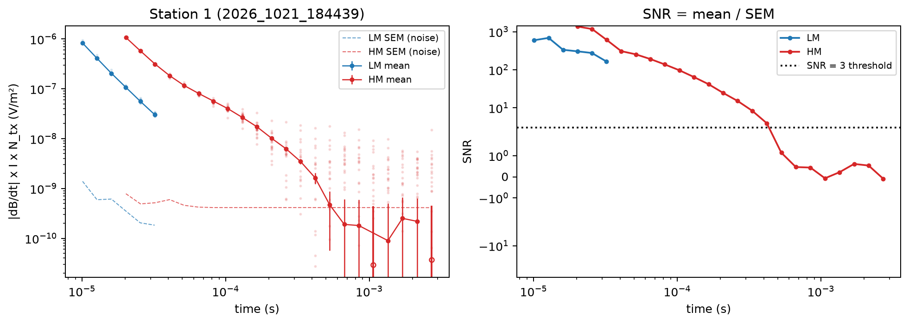
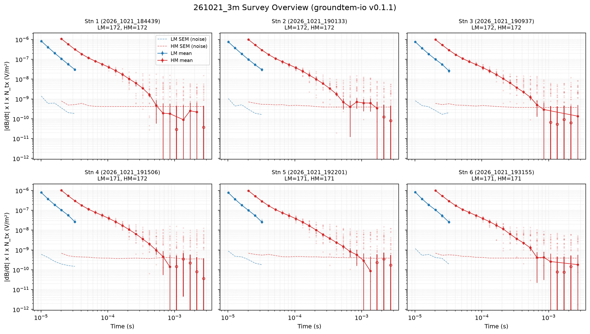

# groundtem-io

Unofficial Python reader and plotting utilities for ABEM GroundTEM i10 time-domain electromagnetic (TDEM) data files:

- **`.stb` binary stack files** (`read_stb`, `StbFile`) — extracts processed gate center times, GPS coordinates, and all individual Low-Moment (LM) and High-Moment (HM) stack records and instrument-reported relative standard deviations.
- **`.stn` station metadata files** (`read_stn`) — parses station/line numbers and GPS coordinates.
- **Survey directories** (`read_sounding_dir`, `read_survey`) — aggregates an entire GroundTEM survey directory into a `pandas.DataFrame` with automatic local metric coordinates (`x_m`, `y_m`) and cumulative profile distance (`dist_m`).
- **`.sts` survey protocol files** (`read_protocol`, `summarize_protocols`, `Protocol`) — parses loop geometry, turn-off ramp duration, current, waveform timings, gate tables, and effective dipole moments.
- **Decay curve & SNR plotting** (`plot_decay`, `plot_station`, `sem`) — visualizes LM/HM transient decay curves, raw stack scatter, SEM noise floor, and gate-by-gate Signal-to-Noise Ratio (SNR).

> **Disclaimer:** This is an independent, unofficial open-source library for reading GroundTEM data files for scientific and interoperability purposes. It is not affiliated with, endorsed by, or sponsored by ABEM or Guideline Geo.

---

## Installation

Install directly from PyPI using `pip` or `uv`:

```bash
pip install groundtem-io
```

```bash
uv add groundtem-io
```

For local development (editable install):

```bash
uv venv
uv pip install -e .
```

---

## Quick Start & Visual Examples

### 1. Single-Station Inspection (`read_stb`, `read_stn`, `plot_station`)

```python
import matplotlib.pyplot as plt
from groundtem_io import read_stb, read_stn, plot_station

# Read station metadata (.stn)
stn = read_stn("path/to/station.stn")
print(stn["StationNo"], stn["Latitude"], stn["Longitude"])

# Read stacked LM / HM decay records (.stb)
stb = read_stb("path/to/sounding.stb")
print("LM gate times (s):", stb.gate_times["LM"])
print("LM stacks shape (n_stacks, n_gates):", stb.data("LM").shape)
print("HM stacks shape (n_stacks, n_gates):", stb.data("HM").shape)

# Plot LM & HM decay curves (with individual stacks) and SNR
fig, axs = plot_station(stb, snr_min=3.0, stacks=True)
plt.show()
```



#### How to Read the Plots

- **Left Panel — Decay Curves (log–log)**
  - **Solid lines with filled circles (`LM mean`, `HM mean`)**: The final **averaged decay curve** from all repeated measurements (stacks) at that station, shown with vertical error bars (`±1 SEM`).
  - **Light background dots (`stacks=True`)**: The **individual repeated measurements** saved in the `.stb` file *before* averaging (every 10th stack is shown by default; pass `stacks=False` to hide them).
    - At **early times**, the dots sit tightly on the solid curve, meaning every repeat measurement gave nearly the same value (strong, clean signal).
    - At **late times**, the dots scatter widely up and down, showing that the ground signal has faded and background noise is taking over.
  - **Open (unfilled) circles**: Late-time gates where the average value became **negative** (drawn as `|value|` so they can be seen on a log scale), a typical sign of noise at late times.
  - **Colored dashed lines (`LM SEM (noise)`, `HM SEM (noise)`)**: The estimated **noise floor** (Standard Error of the Mean, `SEM`) at each time gate. Where the solid curve drops down to touch this dashed line, the signal has reached the noise level.
- **Right Panel — Signal-to-Noise Ratio (`SNR = mean / SEM`)**
  - **Blue / Red curves (`LM`, `HM`)**: Shows how many times stronger the average signal is compared to the noise (`SEM`) at each time gate.
  - **Black dotted horizontal line (`SNR = 3 threshold`)**: A simple **quality cutoff line** (set by `snr_min=3.0`).
    - **Above the dotted line (`SNR ≥ 3`)**: Reliable data gates where the signal is at least 3 times larger than the noise.
    - **Below the dotted line (`SNR < 3`)**: Noisy late-time gates that are usually removed before inversion.

---

### 2. Multi-Station Survey Loading & Grid Plotting (`read_survey`, `plot_decay`)

`read_survey` scans a GroundTEM survey folder (automatically detecting a `Data/` subfolder if present) and returns a `pandas.DataFrame` with one row per sounding:

```python
import matplotlib.pyplot as plt
from groundtem_io import read_survey, plot_decay

# Load all soundings under the survey directory
df = read_survey("path/to/survey_folder")
print(df[["sounding", "station", "line", "n_lm", "n_hm", "dist_m"]].head())

# Plot a 2x3 grid of the first 6 stations
fig, axes = plt.subplots(2, 3, figsize=(14, 8), sharex=True, sharey=True)
for idx, ax in enumerate(axes.flat):
    row = df.iloc[idx]
    plot_decay(ax, row, stacks=True)
    ax.set_title(f"Stn {row['station']} ({row['sounding']})\nLM={row['n_lm']}, HM={row['n_hm']}", fontsize=9)
    ax.grid(True, which="both", ls=":", alpha=0.4)
    if idx == 0:
        ax.legend(fontsize=8)

fig.tight_layout()
plt.show()
```



---

### 3. Reading `.sts` Survey Protocol Files (`read_protocol`, `summarize_protocols`)

```python
from groundtem_io import read_protocol, summarize_protocols

proto = read_protocol("path/to/Protocol.sts")
print("Protocol name:", proto.name)
print("Tx loop size (m):", proto.tx_size, "Turns:", proto.tx_turns)
print("Rx effective area (m^2):", proto.rx_area)
print("LM dipole moment (A*m^2):", proto.dipole_moment("LM"))
print("HM dipole moment (A*m^2):", proto.dipole_moment("HM"))

# Or summarize multiple .sts files into a DataFrame
summary_df = summarize_protocols("path/to/survey_folder")
print(summary_df)
```

---

## API Overview

| Function / Class | Description |
| :--- | :--- |
| `read_stb(path)` | Parse a `.stb` file and return an `StbFile` object (`gate_times`, `stacks`, `header`, `.data(moment)`, `.rel_std(moment)`, `.summary(moment)`). |
| `read_stn(path)` | Parse a `.stn` station file into a dictionary (`StationNo`, `LineNo`, `Latitude`, `Longitude`, etc.). |
| `read_sounding_dir(dir)` | Read a single sounding folder containing `*.stn` and `*.stb` into a summary dictionary. |
| `read_survey(root, pattern="*/*")` | Read all sounding directories under `root` (or `root/Data`) into a `pandas.DataFrame` with `x_m`, `y_m`, and `dist_m`. |
| `read_protocol(path)` | Parse a `.sts` XML protocol file into a `Protocol` dataclass (`tx_size`, `tx_turns`, `rx_area`, `lm`, `hm`, `gates`, `.dipole_moment()`). |
| `summarize_protocols(paths)` | Summarize all `.sts` protocol files in a directory or list into a `pandas.DataFrame`. |
| `plot_decay(ax, source, ...)` | Plot LM and HM decay curves, SEM noise floor, and optional raw stacks on a Matplotlib `Axes`. |
| `plot_station(source, snr_min=3.0, ...)` | Create a two-panel figure showing LM/HM decay curves (left) and gate-by-gate SNR with threshold line (right). |
| `sem(record, moment)` | Compute `max(SEM_emp, SEM_rep)` for a station row dictionary or `pandas.Series`. |

---

## Acknowledgments

Developed with the assistance of **Google Antigravity**.

---

## License

Released under the [MIT License](LICENSE).
